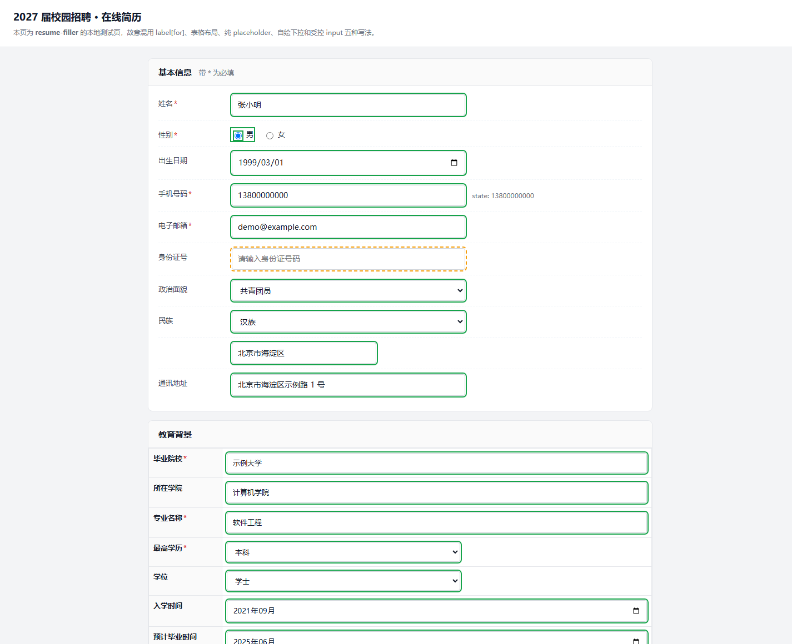

# 网申简历填写助手

> 把简历存进一个本地小软件，到了网申页面粘一段脚本，几十个输入框自动填好。
> **只填不提交**，填完你自己核对再点「投递」。

国内校招/社招的网申系统（北森 Beisen/iTalent、Moka、各类 antd/自绘表单）字段又多又杂：
姓名、手机、身份证、政治面貌、教育经历、工作经历、项目经历、语言能力…… 每投一家公司就要
从头再填一遍，而且每家站的页面写法都不一样。

这个工具把这件苦力活变成三步：

1. 打开软件，把自己的资料填一次（存成本地的 `profile.json`）；
2. 打开任意网申页面，在软件里点「📋 复制填充脚本」；
3. 网页里按 `F12` → 控制台 → `Ctrl+V` → 回车。

页面上的输入框会被逐项填好，并用三种颜色标出来给你核对。



---

## 目录

- [特性](#特性)
- [它是怎么工作的](#它是怎么工作的)
- [快速开始（Windows）](#快速开始windows)
- [三种用法](#三种用法)
- [界面说明](#界面说明)
- [颜色的含义](#颜色的含义)
- [适配过的站点](#适配过的站点)
- [双击没反应 / 打不开怎么办](#双击没反应--打不开怎么办)
- [已知限制](#已知限制)
- [常见问题](#常见问题)
- [隐私与安全](#隐私与安全)
- [自己加字段 / 加规则](#自己加字段--加规则)
- [文件结构](#文件结构)
- [开发与自检](#开发与自检)
- [免责声明](#免责声明)
- [许可](#许可)

---

## 特性

- **数据只在本地。** 简历存在 `profile.json` 里，不联网、不上传、没有账号体系。
- **只填不提交。** 代码里没有任何「点击提交/投递」的路径；填完由你自己核对、自己提交。
- **不编造。** 简历里没写的字段留空（标黄提示「简历未提供」），不会瞎猜一个值填进去。
- **认得各种奇葩控件。** antd 3/4/5 的 Select、DatePicker、Cascader，Element/View 的下拉，
  Moka 的 `sd-Select`，北森 phoenix 的分类选择器，纯 `div` 拼出来的单选框…… 都有专门处理。
- **多段经历能自动加行。** 页面默认只给一行「项目经历」，脚本会照着简历里的条数去点「＋ 添加」。
- **地址级联能拆。** 简历里写「苏州」，会自动定位到「江苏省 → 苏州市」。
- **零安装依赖（填表这一侧）。** 复制出来的是一段自包含 JS，粘进浏览器就能跑。
- **两套驱动。** 不想复制粘贴，也可以让软件自己开一个浏览器（CDP），代码全自动。

## 它是怎么工作的

```
profile.json  ← 你的简历（软件界面里编辑）
rules.json    ← 112 条「页面标签 → 简历字段」的匹配规则
filler.js     ← 跑在网页里的引擎：找控件、认标签、算分、填值、标色
gui.py        ← 桌面界面（tkinter），负责编辑简历 + 一键复制脚本
filler.py     ← 可选：用 Chrome/Edge 的调试协议（CDP）自动驱动浏览器
```

`filler.js` 对页面上的每个输入框做三件事：

1. **认标签**：`label[for]`、`aria-label`、antd 的 `.ant-form-item-label`、北森的
   `.form-item__title`、Moka 的 `[class*="apply-field-"] [class*="title-"]`、
   表格 `<th>`、相邻单元格、只含一个输入框的祖先节点…… 逐级兜底。
2. **判断自己在哪个区块**：按文档顺序找「个人信息 / 教育经历 / 工作经历 / 项目经历 / 语言能力」
   这类标题，这样「开始时间」在教育经历里就是入学时间，在工作经历里就是入职时间。
3. **算分匹配**：完全相等 1000 分 > 前缀匹配 800 > 包含匹配 600 > 反向包含 300，
   再叠加「区块对得上 +40」「规则更精确 + 关键词长度」；命中黑名单（比如「紧急联系人电话」不能填你的手机）
   直接 0 分。

匹配到之后按控件类型分别处理：文本框走原生 setter + `input`/`change` 事件（这样 React/Vue
的受控组件才认），下拉框点开面板按选项文案打分再点，日期控件按日历面板翻页点格子。

## 快速开始（Windows）

### 0. 先确认有没有 Python

按 `Win + R`，输入 `cmd` 回车，敲：

```
python --version
```

- 看到 `Python 3.9` 或更高 → 直接用，跳到第 1 步；
- 提示「不是内部或外部命令」→ 去 <https://www.python.org/downloads/> 装一个，
  安装时**务必勾选 `Add python.exe to PATH`**。

再装唯一的第三方依赖：

```
pip install websockets
```

### 1. 启动软件

双击 **`启动助手.cmd`**（不会弹黑窗口）。

双击没反应？先双击 **`检查环境.cmd`** —— 它会逐项告诉你缺什么，缺的库能顺手帮你装。
还是不行就用 **`调试启动.cmd`**，它会留着黑窗口把报错留在屏幕上。

### 2. 填一次自己的资料

界面有 10 个页签，按顺序填就行：

| 页签 | 内容 |
|---|---|
| 基本信息 | 姓名、性别、出生日期、手机、邮箱、身份证、籍贯、户口、政治面貌、身高体重、紧急联系人等 |
| 教育经历 | 学校、学院、专业、学历、学位、起止时间、GPA、排名（可加多段） |
| 实习·工作 | 单位、职位、部门、起止时间、工作内容（可加多段） |
| 项目经历 | 项目名、角色、时间、描述、成果（可加多段） |
| 竞赛·获奖 | 竞赛名、奖项、时间、说明 |
| 校园经历 | 组织、职务、起止时间 |
| 语言·技能·证书 | CET-4/6、雅思托福、普通话、计算机技能、证书清单 |
| 求职意向 | 应聘岗位、期望城市/行业/薪资、到岗时间、是否服从调剂 |
| 自我评价 | 长版 / 短版 / 优势 / 职业规划（页面有字数限制时会自动换短版） |
| → 填入网页 | 干活的地方 |

填完按 `Ctrl+S`，或者点底部「保存」。数据写进软件目录下的 `profile.json`，下次打开还在。

### 3. 去填网申

1. 在浏览器里登录那家公司的网申系统，走到「填写简历」页面；
2. 回到助手，切到「→ 填入网页」页签，点蓝色的 **📋 复制填充脚本**；
3. 回到网页，按 `F12` 打开开发者工具，切到 **控制台（Console）** 标签；
4. 点一下控制台里的输入行，`Ctrl+V` 粘贴，回车。

> 中文版 DevTools 里「控制台」在「网络」左边第二个；也可以直接按 `Ctrl+Shift+J` 一步到位。
> 如果第一次粘贴时浏览器提示「不允许粘贴」，照着提示在控制台里输入 `allow pasting` 再粘。

几秒钟后页面会变彩色，右下角出现一个小浮层告诉你：扫到多少个控件、填了多少、多少要你自己确认。

**同一个页面想再填一遍**（比如你改了简历）：不用重新复制，直接在控制台敲

```js
__fillAgain()
```

回车即可。页面刷新过就要重新粘贴。

## 三种用法

| 方式 | 怎么做 | 适合谁 |
|---|---|---|
| **A. 控制台脚本**（推荐） | 复制脚本 → 粘到已打开的网页控制台 | 所有人。不碰登录态、不用装额外东西 |
| **B. 自带浏览器** | 软件里填网址 → 点「打开浏览器」→ 登录 → 点「✍ 填入当前网页」 | 想全自动、愿意在软件开的窗口里重新登录一次 |
| **C. Playwright** | `pip install playwright` 后跑 `fill.py` | 会写代码、想批量跑 |

**A 为什么最稳？** 脚本直接在你**已经登录好**的那个页面里执行，不新建窗口、不接管浏览器、
不接触 Cookie，也不受「Edge 已经在运行」这类问题影响。

**B 的坑**：软件是靠「调试端口」去找浏览器的。手动双击 `msedge.exe` 打开的那个窗口**没有**
开调试端口，软件认不出来 —— 必须让软件来启动，或者用 `调试模式开浏览器.cmd`。

## 界面说明

- **底部状态栏**：显示 `profile.json` 的路径和已填字段数。
- **求职意向页底部**：会列出「还没填」的字段，留空的项不会自动补，只会标黄提醒你。
- **→ 填入网页页**：
  - 页面地址 / 浏览器 / 调试端口（方式 B 用）；
  - 简历附件、证件照（可自动塞进上传框，有些站会自校验清空，见「已知限制」）；
  - 运行日志（每次填充的结果都会写在这里，同时落盘到 `out\` 目录）。

## 颜色的含义

| 颜色 | 含义 |
|---|---|
| 🟢 绿色实线 | 已填，值来自简历 |
| 🟡 黄色虚线 | 需要你确认：简历里没有这个值 / 页面这一栏是「推断项」/ 字数超了换成了短版 |
| ⚪ 灰色点线 | 这一栏没认出来是谁（可以点「🔍 扫描页面字段」把清单导出成 CSV，再决定要不要加规则） |

常见「黄色」的合理情况：文件上传框、「本人声明」勾选框、应届生不需要的「现从事行业/现月薪」、
「研究生毕业院校」（本科生不填）、只有一行数据但页面有第二行。

## 适配过的站点

| 站点/框架 | 特征 | 实测结果（单页 30–60 个控件） |
|---|---|---|
| 北森 phoenix（`*.zhiye.com` 新版） | `.form-item__title`、`.phoenix-select`、`.phoenix-calendar`、分类选择器浮层 | 37 项里填 25–26 项，剩余为文件上传/无数据字段 |
| 北森 antd 5 表单 | `.ant-form-item`、`.ant-select`、`.ant-picker` | 36 项里填 25–27 项 |
| Moka 校招（`app.mokahr.com`） | `sd-` 设计系统、`.sugar-portal` 选项、年月成对下拉 | 35 项里填 23 项 |
| 北森 wecruit（`*.hotjob.cn`） | antd **3**（`aria-expanded` 永远 false） | 49 项里填 33 项（含自动加行） |
| 通用 antd/Element 站 | 标准表单控件 | 视页面而定 |

> 数字来自作者自己投递时的实测，每家公司改版都会变。**核心承诺不是"100% 填满"，而是
> "能填的都填对，填不了的明确告诉你"**。

## 双击没反应 / 打不开怎么办

这个软件本身是纯 Python + tkinter 写的，不需要编译、不需要装 Node，但**需要电脑上有 Python**。
按顺序排查：

### 1. 先跑一遍体检

双击 **`检查环境.cmd`**。它会打印：

```
[1] Python   : 3.13.3 (64bit)          ← 版本、解释器路径
[2] tkinter  : ✓ 可用                    ← 没有它就没有界面
[3] 关键文件 : ✓ gui.py …                ← 文件夹是否完整
[4] websockets: ✓ 已安装                 ← 只影响「软件自己开浏览器」
[5] 浏览器   : ✓ Chrome / Edge           ← 只影响「软件自己开浏览器」
```

缺什么，它会在对应的那一行写清楚；`websockets` 没装的话会**当场问你要不要装**。
报告同时写到 `env-report.txt`，出问题可以直接把这个文件发出去。

### 2. 三种最常见的原因

| 现象 | 原因 | 解决 |
|---|---|---|
| 双击什么都不发生 | 电脑上没有 Python，或装时没勾 `Add python.exe to PATH` | 装 <https://www.python.org/downloads/windows/>，安装第一页勾上 PATH 那一项；装完重新双击 |
| 弹出「软件启动失败」窗口，写着 `No module named websockets` | 缺一个库 | 双击 `检查环境.cmd`，按提示按 Y 自动装 |
| 窗口一闪就没了 | 有别的报错被 `pythonw` 吞掉了 | 用 `调试启动.cmd` 看黑窗口里的报错，或看目录下自动生成的 `error.log` |

> 从 v1.2 起，双击失败会**弹出一个说明窗口**，并把完整堆栈写进同目录的 `error.log`，
> 不会再「静默消失」。

### 3. 没有 websockets 也能用

`websockets` 只用于「让软件自己开浏览器（CDP）」那条路。**复制脚本这条路完全不需要它**——
即使这台电脑装不上任何库，只要双击得出界面，就能复制脚本、粘到网页控制台里填表。
界面在缺少它会时会自动把「开浏览器 / 填入网页」几个按钮置灰并在日志里说明。

### 4. 还是不行

把 `env-report.txt` 和 `error.log` 一起发出来，基本能一眼定位。

## 已知限制

- **文件上传**：方式 B/C 可以把文件塞进 `input[type=file]`，但有的站（比如北森）会自己校验并清空，
  这种只能手动点。
- **验证码**：不做，也不该做。
- **iframe**：跨域的 iframe 里的控件填不到。
- **由页面托管的输入框**：极少数输入框（例如某些站的「专业」联想框）每次写入都会被页面还原，
  这种会明确报「请手填」。
- **日期控件**：识别了几种主流写法（antd 3/4/5、phoenix 日历、年月下拉对），但没见过的日历
  面板可能要手动点一次。
- **不会提交**：这是设计约束，不是缺陷。

## 常见问题

**Q：双击 `启动助手.cmd` 没反应？**
A：用 `调试启动.cmd`，或者先确认 `python --version` 能出版本、`pip install websockets` 装过。

**Q：粘贴脚本后控制台报 `Unexpected token` / 什么都没发生？**
A：多半是没粘全（脚本有 10 万字符左右）。点「📋 复制填充脚本」重新复制一次，确认粘贴后
控制台最后一行显示 `✔ 已注入 ResumeFiller`。

**Q：填完有几个框是空的？**
A：看右下角浮层的数字，或者 `out\report-*.md` 里的「需人工」清单，每条都写了原因。

**Q：会影响我已经填过的内容吗？**
A：只会覆写它成功匹配到的字段；匹配不到的保持原样。建议第一次先点「👁 只看不改（预览）」看一眼。

**Q：为什么有些公司的页面填得特别准，有些很一般？**
A：标签写法差别很大。作者已经针对北森/Moka/antd 逐站调过；遇到没适配的站，可以用
「🔍 扫描页面字段」导出 CSV，对着加几条规则（见下一节）。

## 隐私与安全

- **所有数据都在本地。** `profile.json` 就在软件目录里，纯文本，你可以随时打开看、改、删。
- **软件不联网。** 没有账号、没有遥测、没有云端同步。唯一的网络行为是你自己让它打开网页。
- **仓库里不含任何真实个人信息。** 出厂 `profile.json` 是全空模板，示例截图用的是虚构人物。
- **`out\` 目录里的报告/截图含你填的内容**，分享给别人的时候别带上。
- **`.browser-profile\` 是浏览器登录态**，同样不要分享。
- 这个工具会**读到**你页面上的内容（为了认标签），但不会把这些内容发到任何地方。

## 自己加字段 / 加规则

想让它认识一个新栏位，在 `rules.json` 的 `rules` 数组里加一条即可（顺序即优先级，越靠前越优先）：

```json
{
  "id": "wechat",
  "keys": ["微信号", "微信", "WeChat"],
  "path": "basic.wechat",
  "not": ["公众号", "二维码"]
}
```

字段说明：

| 字段 | 说明 |
|---|---|
| `id` | 唯一，写日志和报告时用它 |
| `keys` | 页面上可能出现的标签文案（越大越具体越好） |
| `path` | 取 `profile.json` 里的哪个值，`education.0.school` 这种点号路径 |
| `list` + `field` | 多段经历用：`list: "projects"`、`field: "name"`，会按行号依次消费 |
| `format` | `date` / `digits` / `year`，填之前先格式化 |
| `aliases` | 值 → 选项文案的映射，比如 `{"是": ["是", "同意", "服从"]}` |
| `section` | 只在某个区块里生效，`"教育|学历"` 是正则 |
| `not` | 标签里出现这些词就不匹配（防止「紧急联系人电话」被填成你的手机） |
| `unsure` | 只标黄、不写值（用于「本人声明」这种必须人工确认的） |
| `aggregate` | 多段内容拼成一句填进同一个框（用于「校内职务」这类汇总栏） |

加完规则跑一下 `python _validate.py`，它会检查路径是否存在、id 是否重复、有没有拼错。

## 文件结构

```
resume-form-autofill/
├── 启动助手.cmd            双击启动（无控制台窗口；找不到 Python 会给出提示）
├── 检查环境.cmd            环境体检：Python / tkinter / websockets / 浏览器，缺的能一键装
├── _env_check.py           体检脚本本体（会写 env-report.txt）
├── 调试启动.cmd            带控制台启动，报错看得见
├── gui.py                  桌面界面（tkinter，标准库）
├── filler.py               可选：CDP 驱动（自动开浏览器、截图、写报告）
├── filler.js               跑在网页里的填充引擎（自包含，不依赖任何库）
├── rules.json              112 条字段匹配规则
├── profile.json            你的简历（出厂为空模板）
├── make_snippet.py         把引擎 + 规则 + 简历打包成一段可粘贴的脚本
├── _validate.py            规则/简历一致性检查
├── _checkjs.py             JS 语法检查（需要 esprima）
├── demo/
│   ├── form.html           本地练习页（混了 5 种常见写法）
│   └── rows.html           多段经历 + 「添加」按钮的练习页
└── docs/                   截图
```

## 开发与自检

```bash
pip install websockets esprima   # esprima 仅 _checkjs.py 需要

python _validate.py              # 规则 vs 简历：重复 id、路径不存在、格式错误
python _checkjs.py               # filler.js 语法检查
python make_snippet.py           # 重新打包 out/console-fill.js
python filler.py --demo --headed # 用自带浏览器跑本地练习页，出截图 + 报告
```

`filler.py --demo` 会打开 `demo/form.html`，填一遍，然后把报告写到 `out\report-*.md`、
截图写到 `out\fill-*.png`。改完引擎先跑它，比在真实网站上试快得多。

## 免责声明

本项目是个人效率工具，帮你把**自己**的简历更快地填进网申表单。

- 请只用于填写你自己的真实信息；
- 填完必须自己核对每一项再点提交，工具不会、也不该替你提交；
- 各招聘平台的用户协议请自行遵守，由此产生的一切后果由使用者自负。

## 许可

[MIT](LICENSE)
